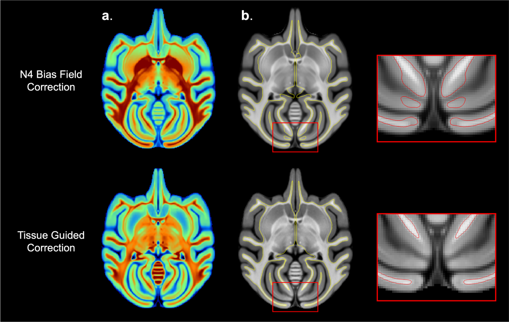

# Tissue-Guided Bias Field Correction

Tissue-guided bias field correction for brain MRI that leverages tissue segmentation to recover high-frequency intensity variations typically lost in standard N4 correction. Part of the MacaSurfer cortical analysis pipeline.

## Motivation

Standard N4 bias field correction tends to over-smooth intensity profiles, particularly in deep cortical folds where thin white matter structures require precise intensity recovery. The tissue-guided approach addresses this by using tissue class information (GM, WM, CSF) to constrain the bias field estimation, preserving high-frequency intensity variations that are critical for accurate cortical surface reconstruction.



**Figure 1. Impact of Tissue-Guided Bias Field Correction on White Surface Generation.** (a) Comparison of bias field-corrected T1 between standard N4 correction (top) and the proposed Tissue-Guided method (bottom). The proposed method recovers high-frequency variations in deep cortical folds. (b) The resulting white matter surface reconstructions. The red insets demonstrate that Tissue-Guided correction prevents boundary erosion in the occipital lobes (bottom right), preserving the continuity of thin white matter strands compared to N4 correction (top right).

## Methods

Two complementary approaches are provided:

### 1. Gaussian Mixture (EM-style) — `bfc_gauss_mixture.py`

Iterative expectation-maximization framework that alternates between:
- Estimating class-conditional intensity distributions (tissue means and variances)
- Computing the bias field residual from tissue-weighted intensity deviations
- Progressively refining the bias estimate across multiple scales (coarse-to-fine kernel schedule)

Suitable for standard T1/T2 brain MRI with or without initial tissue priors.

### 2. RBF Scatter-Point (GPU-accelerated) — `bfc_rbf_scatter.py`

Fast GPU-accelerated bias field estimation using adaptive scatter control points with RBF interpolation:
- Adaptive control point placement: uniform sampling combined with high-variance region targeting
- Soft tissue labels with Gaussian smoothing for robust tissue probability estimation
- Regularized optimization (bias energy, point spacing, boundary constraints, gradient smoothness)
- Sub-linear complexity via K-nearest-neighbor RBF approximation

Suitable for large datasets and scenarios requiring fast, flexible bias field modeling.

## Installation

```bash
pip install numpy scipy nibabel SimpleITK torch scikit-learn
```

For GPU acceleration (recommended for `bfc_rbf_scatter.py`), ensure PyTorch with CUDA support is installed.

## Usage

### Gaussian Mixture Method

```bash
python bfc_gauss_mixture.py \
    --input_img T1w.nii.gz \
    --input_lab tissue_labels.nii.gz \
    --input_msk brain_mask.nii.gz \
    --output_img T1w_corrected.nii.gz \
    --output_bias bias_field.nii.gz \
    --modality T1
```

| Argument | Description |
|----------|-------------|
| `--input_img` | Input T1/T2-weighted image |
| `--input_lab` | Initial tissue segmentation (GM=2, WM=3) |
| `--input_msk` | Brain mask |
| `--bias_max_iter` | Number of bias estimation iterations (default: 10) |
| `--max_kernel` | Initial bias field smoothing kernel size (default: 9) |
| `--modality` | `T1`, `T2`, or `None` (preserve original contrast) |

### RBF Scatter-Point Method

```bash
python bfc_rbf_scatter.py \
    --input_img T1w.nii.gz \
    --input_lab tissue_labels.nii.gz \
    --input_msk brain_mask.nii.gz \
    --output_img T1w_corrected.nii.gz \
    --output_bias bias_field.nii.gz \
    --n_points 48 \
    --rbf_sigma 0.05 \
    --max_iter 25
```

| Argument | Description |
|----------|-------------|
| `--n_points` | Number of scatter control points (default: 48) |
| `--rbf_sigma` | RBF kernel width (default: 0.05) |
| `--max_iter` | Maximum optimization epochs (default: 25) |
| `--use_label_value` | Use single label value with B-spline N4 instead (bypasses RBF) |

## Repository Structure

```
├── bfc_gauss_mixture.py       # EM-style iterative bias field correction
├── bfc_rbf_scatter.py         # GPU-accelerated scatter-point RBF correction
├── examples/
│   └── tissue_guided_biasfieldcorrection_examples.ipynb
├── resources/
│   ├── T1w_04mm.nii.gz         # Example T1 image
│   └── T1w_label_04mm.nii.gz   # Example tissue labels
└── figures/
    └── tissue_guided_bfc.png   # Figure 1
```

## Citation

If you use this method in your research, please cite:

> Wei, Y. et al. *MacaSurfer: unified surface-volume mapping of the macaque brain across the lifespan.* 2026.06.14.732101 Preprint at https://doi.org/10.64898/2026.06.14.732101 (2026).
